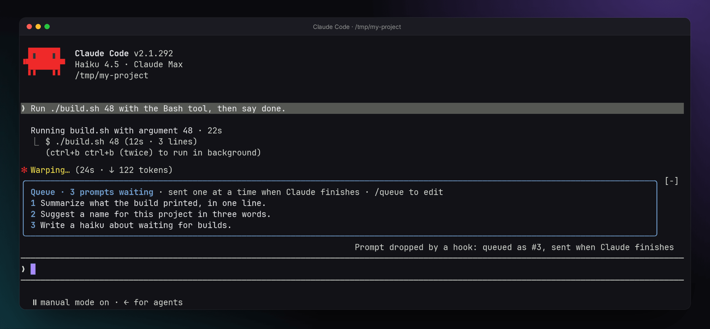

# Claude Code mods

Mods for Claude Code, by [Florian Anthony](https://florian-anthony.ch).

| Mod | What it does |
|---|---|
| [prompt-queue](plugins/prompt-queue) | Keeps the prompts you send while Claude works in a queue and sends them one by one, each once Claude has finished. Edit, reorder or remove them with `/queue`. |



## Install

In Claude Code:

```
/plugin marketplace add florian-anthony/claude-code-mods
/plugin install prompt-queue@florian-anthony
```

Each mod lives in `plugins/<name>` with its README and tests. Tested with Claude Code 2.1.292.

## License

[MIT](LICENSE)
