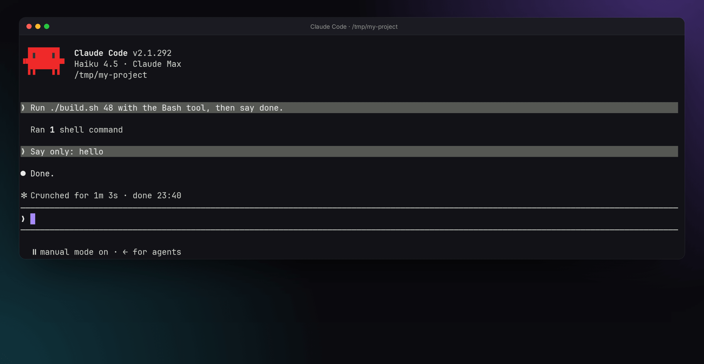
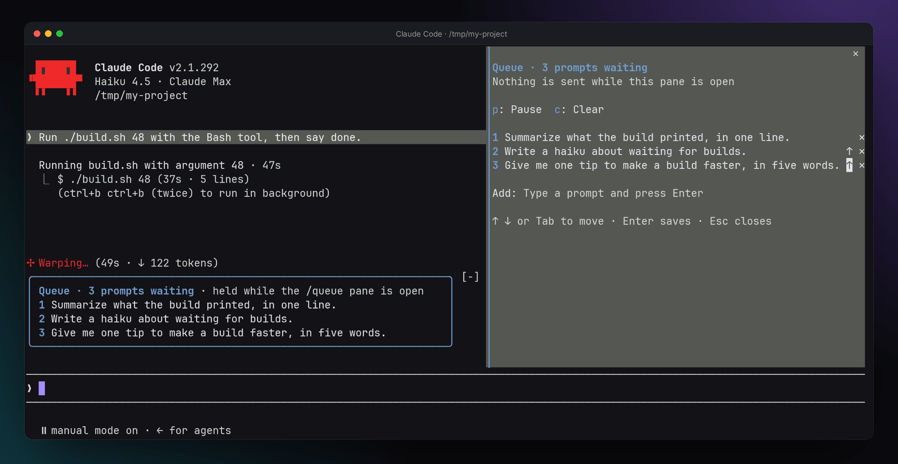
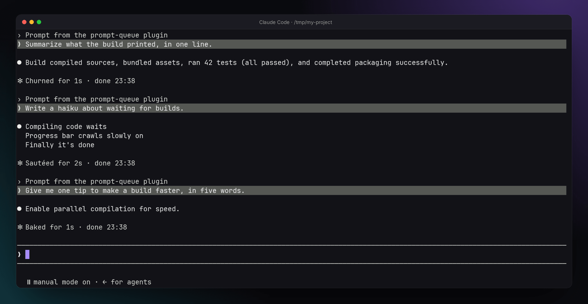
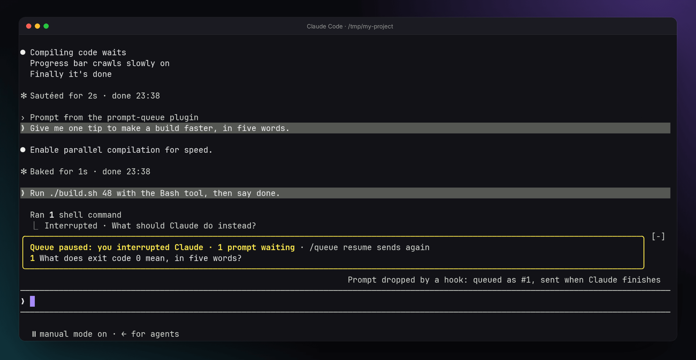

# prompt-queue

Keep typing while Claude works. Your prompts wait in a queue and go one at a time, each once Claude has finished the turn before it.


## Why

Claude Code already holds a prompt you send during a turn, but it hands that prompt to the running turn as soon as a tool call returns. Claude then reads it in the middle of its task. We asked Claude Haiku 4.5 on Claude Code 2.1.292 to run a build and then say "done", and sent "Say only: hello" during the build, three times. Twice, Claude answered "hello" and never said "done". Once, it said "Done." and never answered the message.



prompt-queue keeps the prompt until the turn has ended, then sends it as a turn of its own.

## What it does

- While Claude works, what you send from the prompt box, or from your phone through Remote Control, joins the queue. The band above the prompt box lists it.
- When the turn ends, the first prompt is sent as if you had typed it. The next one goes when that turn ends. A subagent finishing does not count: only the end of the main turn sends.
- `/queue` opens the queue. Rewrite a prompt in place, move it up with ↑, remove it with ✕, or add one at the bottom. Nothing is sent while the pane is open.
- If you interrupt Claude, or a turn ends with an error or a refusal, the queue pauses. `/queue resume` sends again.







## Commands

| Command | Effect |
|---|---|
| `/queue` | Open the queue |
| `/queue <prompt>` | Add a prompt, sent at once if Claude is idle |
| `/queue pause` | Hold the queue |
| `/queue resume` | Send again |
| `/queue clear` | Empty the queue |

In the pane, ↑ ↓ or Tab move between fields and Enter saves a prompt. Saving an empty prompt removes it. Outside a field, `p` pauses or resumes and `c` clears. Esc closes the pane.

## What it lets through

- Slash commands, which act at once.
- Prompts with an attachment, such as a pasted image, which would be lost on the way.
- Prompts that do not come from you: notifications, scheduled tasks, other sessions or plugins.

## Limits

- The queue lives in memory and empties when Claude Code restarts.
- A queued prompt keeps its `@file` mentions as plain text. In our test, Claude read the file with a tool call once the prompt was sent.

## How it works

The mod is one TypeScript module, [`hooks/register.ts`](hooks/register.ts). Claude Code calls its `register(on)` once, and each `on(event, handler)` hooks an engine event.

- Hooks chain like middleware. A handler receives the event and `next`: it passes the event on or answers it. `prompt.submit` answers `{ drop }` to hold a prompt typed during a turn.
- `turn.complete` sends the next prompt with `$.prompt.submit({ text, asUser: true })`. A command or a button defers that call with `$.clock.after(0)`, because submitting waits for the turn slot the command itself holds.
- The band and the pane are declarative, like React components. A `ui.render` hook returns `Box`, `Text`, `Button` and `Input` elements. Each prompt's field is keyed by its id, so an edit survives a redraw, and `$.ui.invalidate` asks for a redraw whenever the queue changes.
- `claude plugin test` runs 8 tests against the engine, with stubs and a mock clock. One covers a race found while filming the demo: a turn that ends while you edit the queue.

## Develop

```
claude plugin validate --strict plugins/prompt-queue
claude plugin test plugins/prompt-queue
claude --plugin-dir plugins/prompt-queue
```

Tested with Claude Code 2.1.292 on Linux.

## License

[MIT](../../LICENSE)
